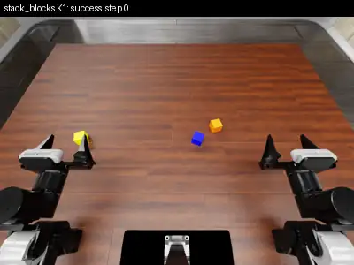
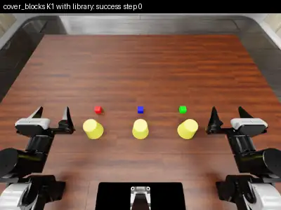

<div align="center">

# Where is Physical RSI capability from?<br>An Observational Scaling Law of LLM-as-policy

**PhysRSI-Eval** · [Paper (arXiv 2610.26848)](https://arxiv.org/abs/2610.26848) · [Project page](https://physrsi-eval.github.io/)

Zekai Li\*, Jiayi Yu\*, Jinlu Zhang\*, Luyang Niu\*, Zekun Qi\*, Jun Zheng, Xuchuan Chen, Dairu Liu, Yintianrun Zhang, He Wang†, Li Yi†<br>
Galbot Team · \* Equal contribution · † Corresponding authors

</div>

PhysRSI-Eval quantifies **physical recursive self-improvement (RSI)**. An LLM agent controls a dual-arm robot in
[RoboDojo](https://github.com/RoboDojo-Benchmark/RoboDojo) simulation and keeps a persistent workspace of skills,
tools, policy code and memory. It revises that workspace after every judged physical attempt. The benchmark scores
this process on five axes (First-Attempt Performance, Efficiency, Success, Budget, Improvement) across 18
manipulation tasks under a fixed interaction budget. It asks three questions:

- **Q1**: Where does the capability come from?
- **Q2**: How can it be quantified, and does it follow a scaling law?
- **Q3**: Does it generalize, or does it overfit?

This repository is the **benchmark infrastructure**: a reference implementation of the evaluation loop that runs on
your own machine. It covers four tasks from the paper's generalization study. External dependencies (RoboDojo, its
assets, Isaac Sim, the Codex CLI) are installed from their upstreams at pinned versions with one script.
[Jump to Getting started ↓](#getting-started)


## Episodes

Each preview is a time-lapse of the overhead camera. Click a preview for the full three-camera video
(cam_high | left wrist | right wrist, 25 Hz).

| `stack_blocks_by_language` | `cover_blocks` | `plug_in_charger` | `insert_key` |
|:---:|:---:|:---:|:---:|
| [](docs/media/stack_blocks_K1_astra_success.mp4) | [](docs/media/cover_blocks_K1_transfer_success.mp4) | [](docs/media/plug_in_charger_K7_success.mp4) | [](docs/media/insert_key_K1_partial.mp4) |
| GPT-6 Astra, K1, success (213 steps)<br>*recorded with this repository* | Sonnet 5.5, K1 with transfer, success | Sonnet 5.5, K7, success | Sonnet 5.5, K1, score 0.15<br>*(no system solved it by K17)* |

## Benchmark: a controlled loop of physical attempts


The model weights stay fixed. The agent's workspace (skills, tools, policy, memory) is what changes.

- **Evaluate (K0)**: one in-context episode through the shared robot tools, with no workspace. It runs three times
  per task and the scores are averaged.
- **Optimize (K1–K17)**: each round is one physical attempt from the persistent workspace.
  - The attempt is graded by RoboDojo's own grader.
  - The agent then revises the workspace with robot actions closed, and the revision is committed for the next
    round.
  - The chain stops at the first native success, or after 17 rounds.

The **five axes** are A1 First-Attempt Performance, A2 Efficiency, A3 Success, A4 Budget and A5 Improvement;
definitions are in the paper. The **tasks** are 18 RoboDojo tasks, three per difficulty stratum (D1, highest
official success rate, to D6, lowest), covering RoboDojo's five official task categories.


### Tasks in this repository

| Task | RoboDojo category | Official success | Stratum | Steps | Scoring (tiers, %) |
|---|---|---|---|---|---|
| `stack_blocks_by_language` | Open | 40% (20/50) | D2 | 400 | graded [20, 100] |
| `cover_blocks` | Memory | 46% (23/50) | D2 | 800 | graded [0, 0, 5, 15, 30, 100] |
| `insert_key` | Precision | 0% (0/50), score 14.4 | D4 | 300 | graded [15, 100] |
| `plug_in_charger` | Precision | 0% (0/50), score 0 | D6 | 400 | binary |

Instructions, clarifications, scoring and pinned file hashes are in [docs/tasks.md](docs/tasks.md).

## Results: five-axis profiles

| System | Tasks | A1 First-Attempt | A2 Efficiency | A3 Success | A4 Budget | A5 Improvement |
|---|---:|---:|---:|---:|---:|---:|
| GPT-6 Astra | 18 | 0.3676 | 0.8594 | 0.8509 | 0.8429 | 0.7500 |
| GPT-6.1 Sol | 18 | 0.2843 | 0.8224 | 0.7028 | 0.8081 | 0.5714 |
| GPT-6 Sol | 18 | 0.0306 | 0.4658 | 0.4722 | 0.3718 | 0.3889 |
| GPT-5.6 Sol | 18 | 0.0120 | 0.2247 | 0.1037 | 0.3013 | 0.0556 |
| Claude Opus 5.5 | 18 | 0.1769 | 0.6091 | 0.7444 | 0.5794 | 0.6875 |
| Claude Sonnet 5.5 | 18 | 0.1241 | 0.6946 | 0.7006 | 0.6984 | 0.5625 |
| Gemini 4\* | 10 | 0.0500 | 0.7831 | 0.6350 | 0.6241 | 0.6000 |

K0 scores are averaged over three runs per task. \*Gemini 4 was evaluated on ten tasks, with one K0 run per task.

### Q1: Where is Physical RSI capability from?

Different aspects of improvement may have different capability bottlenecks. Spatial reasoning is associated with
starting well. Perception is associated with interpreting failures and recovering from them. Strong coding cannot
always compensate for a weakness elsewhere.


### Q2: How can we quantify Physical RSI and its scaling law?

Public capability profiles reproduce the observed order of both the best score reached by K17 and the half-gain
round T50. Interactive curves and radar plots are on the [project page](https://physrsi-eval.github.io/).

### Q3: Does Physical RSI reflect overfitting or generalization?


In cross-task transfer, a target task starts from a workspace pooled from all other tasks. The example below is
Sonnet 5.5 on `cover_blocks`:

| K1 from an empty workspace: fail (800/800 steps) | K1 with the transfer library: success (501 steps) |
|:---:|:---:|
| [](docs/media/cover_blocks_K1_scratch_fail.mp4) | [](docs/media/cover_blocks_K1_transfer_success.mp4) |

- **From scratch**, the chain first succeeds at **K9**.
- **With the library**, it succeeds at **K1**. In that round the agent read the `stack_blocks_by_language`
  material: its notes, the verified segments of its winning grasp-and-transfer run
  ([source episode](docs/media/stack_blocks_K2_source_success.mp4)), and its image-segmentation helper. It reused
  that routine to place cups over blocks.

The insertion pair in the teaser (`insert_key` → `plug_in_charger`) illustrates the same mechanism. None of our
runs produced a successful transfer for that pair.

## Getting started

### 1. Install (one command)

Requirements: Linux, an NVIDIA RTX-class GPU supported by Isaac Sim 5.1, git and git-lfs, conda (installed by
RoboDojo's installer if missing), npm, and a Codex login (`codex login`).

```bash
git clone https://github.com/PhysRSI-Eval/PhysRSI-Eval-code.git
cd PhysRSI-Eval-code
bash scripts/setup.sh
```

The script runs these steps in order:

1. Clones RoboDojo at the pinned commit with its pinned submodules (XPolicyLab, IsaacLab, cuRobo).
2. Runs RoboDojo's installer, which creates the conda env `RoboDojo` with Isaac Sim 5.1, IsaacLab and cuRobo.
3. Downloads the RoboDojo assets at the pinned dataset revision.
4. Installs this package and the Codex CLI version used in the paper.
5. Writes `configs/local.json` and verifies everything.

All pins are in [tasks/lock.json](tasks/lock.json).

### 2. Verify

```bash
PY=$(python3 -c "import json;print(json.load(open('configs/local.json'))['robodojo_python'])")
$PY -m physrsi_eval check                      # versions, sha256 of task files and layouts, Python stack, GPU, Codex
$PY -m physrsi_eval check --smoke insert_key   # launch Isaac, reset the pinned layout, one action, grade (no model)
$PY tests/test_host.py                         # host logic against a fake simulator (no GPU, no model)
```

### 3. Run the benchmark on a task

```bash
S=gpt-6-astra                                              # any file in configs/systems/
$PY -m physrsi_eval k0    --system $S --task insert_key    # Evaluate: 3 episodes, mean score
$PY -m physrsi_eval chain --system $S --task insert_key    # Optimize: K1..K17, stop at first success
```

A round can take up to about 70 minutes of model time plus simulation, so run long jobs inside `tmux`. Commands are
resumable: committed rounds are kept, and an interrupted round is moved aside and rerun.

### 4. Cross-task transfer

```bash
$PY -m physrsi_eval chain    --system $S --task stack_blocks_by_language
$PY -m physrsi_eval transfer --system $S --target cover_blocks \
    --source stack_blocks_by_language=runs/$S/stack_blocks_by_language/c1   # repeat --source to pool more tasks
```

`scripts/run_generalization.sh [system]` runs the whole four-task generalization set: sources, targets from
scratch, transfers and videos.

### 5. Videos

```bash
$PY -m physrsi_eval video --chain runs/$S/cover_blocks/transfer-c1 --out videos/ --gif
```

This writes one three-camera MP4 per round (25 Hz, libx264), plus an animated WebP preview with `--gif`.

### Outputs

```
runs/<system>/<task>/K0/r{1,2,3}/            Evaluate episodes; K0/summary.json holds the mean score
runs/<system>/<task>/<chain>/K<kk>/
    workspace/   the agent's workspace during round k     snapshot/  committed after the revision
    sim/         per-step camera PNGs, states.jsonl, evaluation_outcome.json, simulator log
    client/      observation packets, actions, history, receipt.json (the grade)
    agent/       Codex event log (images stripped), reasoning-budget.json
runs/<system>/<task>/<chain>/curve.json, summary.json     per-round score, first-success round
```

### Configuration (`configs/local.json`)

| Key | Meaning |
|---|---|
| `robodojo_root`, `robodojo_python` | RoboDojo checkout and its Python (set by `setup.sh`) |
| `gpu`, `vulkan_index` | CUDA index and the Vulkan index of the same GPU (multi-GPU hosts) |
| `kit_cache_dir`, `ext_folders` | Isaac extension cache, and offline extension folders for hosts without registry access |
| `program.sandbox` | `auto` (bubblewrap if usable), `bwrap` or `none`, for the agent's own programs |
| `layout_id` | scene layout (0 in the paper's main evaluation) |

## Protocol summary

Full details are in [docs/protocol.md](docs/protocol.md).

- **Agent**: Codex app-server with no system prompt. Shell, web search and all other built-in tools are disabled.
  - The only tools are the host's: `robodojo_contract`, `robodojo_start`, `robodojo_act` and `r1_notes`.
  - Optimize rounds add `m1_files`, `m1_program` and `m1_development`.
- **Actions**: dual-arm EEF targets, at most 5 cm / 0.35 rad from the current pose, executed for 1–5 control steps
  at 25 Hz. Every reply returns a state JSON and three 640×480 images.
- **Budgets**: 4200 s of model time per round, measured as turn time minus host tool time. The revision window is
  1800 s (GPT systems; 600 s for the Claude systems in the paper). Each attempt is limited to the task's native
  step limit.
- **Revision**: the grade and failure reason arrive with the closing tool reply. The agent revises its files and
  must write `memory/improvements/K<k>.json`. The workspace is then committed.

## Repository layout

```
physrsi_eval/   sim_server.py (inside Isaac) · sim.py · tools.py · program.py · evidence.py · agent.py (Codex)
                loop.py · transfer.py · video.py · protocol.py (agent-facing texts) · tool_specs.json
tasks/          four task definitions and lock.json (pins)
configs/        systems, transfer pairs, local config template
scripts/        setup.sh, run_generalization.sh
docs/           protocol.md, tasks.md, media/ (compressed previews)
tests/          test_host.py
```

## Scope

- **Same protocol, reduced host.** The paper's runs used a larger production host with the same agent-facing
  protocol. Its account routing, isolation, crash recovery and monitoring are deliberately not included here.
  Running the first 40 steps of a production episode's actions through this repository gives bit-identical robot
  states.
- **Client.** Only the Codex client is included. The Claude systems in the paper used Claude Code with the same
  tool contract.
- **Program sandbox.** The agent's programs run under bubblewrap when the host allows unprivileged namespaces.
  Otherwise they run in the workspace directory, and any file change fails the call.

## Citation

```bibtex
@misc{li2026physicalrsicapabilityfrom,
  title={Where is Physical RSI capability from? An Observational Scaling Law of LLM-as-policy},
  author={Zekai Li and Jiayi Yu and Jinlu Zhang and Luyang Niu and Zekun Qi and Jun Zheng and Xuchuan Chen and Dairu Liu and Yintianrun Zhang and He Wang and Li Yi},
  year={2026},
  eprint={2610.26848},
  archivePrefix={arXiv},
  primaryClass={cs.RO},
  url={https://arxiv.org/abs/2610.26848}
}
```

## License

Apache-2.0 for this repository. RoboDojo, its assets, Isaac Sim and the Codex CLI keep their own licenses.
