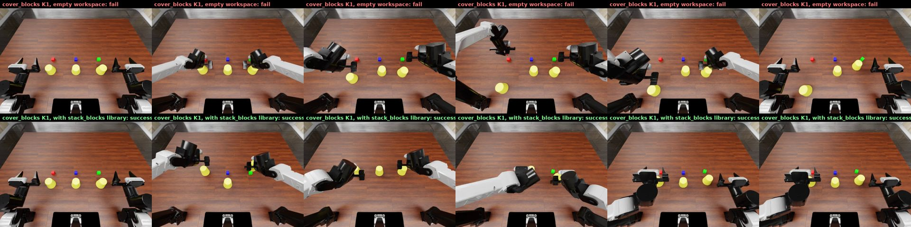

# PhysRSI-Eval: reference infrastructure

Reference implementation of the evaluation loop from **PhysRSI-Eval** ([project page](https://physrsi-eval.github.io/)):
a frontier LLM agent controls a dual-arm robot in [RoboDojo](https://github.com/RoboDojo-Benchmark/RoboDojo)
simulation through bounded end-effector actions. Across rounds it keeps a persistent workspace (skills, tools,
policy code, memory) that it revises from the outcome of each judged physical attempt.

This repository contains **only the infrastructure**: the simulator bridge, the agent's tools, the round loop,
cross-task transfer and video rendering. It ships no model outputs, no trajectories and no assets. RoboDojo,
its assets, Isaac Sim and the Codex CLI are installed from their upstreams at pinned versions by one script.

## What is included

Four RoboDojo tasks illustrate the generalization experiments (paper Q3 and the teaser): two source tasks and
the two targets they transfer to.

| Task | RoboDojo category | Official success (RoboDojo, 50 runs) | Stratum | Steps | Scoring (tiers, %) |
|---|---|---|---|---|---|
| `stack_blocks_by_language` | Open | 40% (20/50) | D2 | 400 | graded [20, 100] |
| `cover_blocks` | Memory | 46% (23/50) | D2 | 800 | graded [0, 0, 5, 15, 30, 100] |
| `insert_key` | Precision | 0% (0/50), score 14.4 | D4 | 300 | graded [15, 100] |
| `plug_in_charger` | Precision | 0% (0/50), score 0 | D6 | 400 | binary |

Strata come from the official RoboDojo leaderboard: 18 tasks ordered by official success rate (ties broken by
official score), three tasks per stratum, D1 easiest to D6 hardest
([docs/tasks.md](docs/tasks.md)).

Transfer pairs highlighted in the paper teaser ([configs/transfer_pairs.json](configs/transfer_pairs.json)):

- `stack_blocks_by_language` → `cover_blocks`: reuse of a closed-loop grasp-and-transfer routine
  (from stacking a block to placing a cup over a block).
- `insert_key` → `plug_in_charger`: reuse of an insertion routine (from key to charger).

## Generalization example: stack blocks → cover blocks



Sonnet 5.5 is shown, from the paper's runs (cam_high view; videos:
[side-by-side comparison](docs/media/stack_to_cover_K1_comparison.mp4),
[source task, stack_blocks K2 success](docs/media/stack_blocks_K2_source_success.mp4)).

- **From scratch**: starting from an empty workspace, `cover_blocks` first succeeds at **K9** (top row: K1 fails
  and uses all 800 steps).
- **With transfer**: starting from a library pooled from the other tasks, it succeeds at **K1** (bottom row,
  501 steps). In that round the agent read the `stack_blocks_by_language` material: its notes, the verified
  segments of its winning grasp-and-transfer run, and its image-segmentation helper. The same routine then
  placed cups over blocks.

The insertion pair in the teaser (`insert_key` → `plug_in_charger`) is a schematic of the mechanism. None of our
runs produced a successful transfer for that pair, so no video is shown for it.

The videos in `docs/media/` are compressed web versions. `python -m physrsi_eval video` renders full-resolution
three-camera videos from any run.

## Protocol in brief

Full details are in [docs/protocol.md](docs/protocol.md).

- **K0 (Context)**: no workspace. Prompt `evaluate task`, robot tools only. Three independent episodes per task;
  the reported value is the mean score.
- **K1–K17 (Harness)**: prompt `optimize task`. K1 starts from a workspace that is empty except for the host's
  read-only `tools/mcp_client.py`. Each round is one judged physical attempt, followed by a revision with robot
  actions closed. The revised workspace is committed for the next round. The chain stops at the first native
  success (H = 17).
- **Scene**: layout group 0, layout 0 for every round.
- **Actions**: dual-arm EEF targets, at most 5 cm / 0.35 rad from the current pose, executed for 1–5 control
  steps at 25 Hz. Every reply returns a state JSON and three 640×480 camera images.
- **Budgets**: 4200 s of measured reasoning per round. The revision window is 1800 s for the GPT systems
  (600 s for the Claude systems in the paper). The physical budget is the native step limit of each attempt.
- **Agent**: Codex CLI app-server with no system prompt. Shell, web search and every other built-in tool are
  disabled. The agent has only the host's dynamic tools:
  `robodojo_contract`, `robodojo_start`, `robodojo_act` and `r1_notes`. Harness rounds add `m1_files`,
  `m1_program` and `m1_development`.
- **Instructions**: three of the four tasks append a clarification to RoboDojo's instruction (for example, the
  key must be fully seated and turned, not left tilted). The grader is unchanged. Both strings are in
  `tasks/<task>/task.json`.

## Setup

Requirements: Linux, an NVIDIA RTX-class GPU supported by Isaac Sim 5.1, git and git-lfs, conda (installed by
RoboDojo's installer if missing), npm (for the Codex CLI) and a Codex login (`codex login`).

```bash
bash scripts/setup.sh
```

The script runs these steps in order:

1. Clones RoboDojo at the pinned commit with its pinned submodules (XPolicyLab, IsaacLab, cuRobo).
2. Runs RoboDojo's own installer, which creates the conda env `RoboDojo` with Isaac Sim 5.1, IsaacLab and cuRobo.
3. Downloads the RoboDojo assets at the pinned dataset revision.
4. Installs this package into that env, along with the Codex CLI version used in the paper.
5. Writes `configs/local.json` and verifies every pin.

All pins are in [tasks/lock.json](tasks/lock.json). These include the sha256 of the four task files, their task
configs and their evaluation layouts.

Verify at any time (add `--smoke TASK` to launch the simulator once without a model):

```bash
bash scripts/setup.sh --verify
python -m physrsi_eval check --smoke insert_key
```

To reuse an existing RoboDojo environment, set `ROBODOJO_PYTHON=/path/to/python` and `PHYSRSI_DEPS`. On
multi-GPU hosts, set `gpu` (CUDA index) and `vulkan_index` (the Vulkan index of the same GPU) in
`configs/local.json`.

On first start, Isaac Sim fetches two extensions from NVIDIA's extension registry: `omni.kit.pip_archive` and
`isaacsim.asset.importer.urdf`. They are cached in `kit_cache_dir` (default `runs/.kit-cache`) and reused by
every later run. On hosts without registry access, copy these extensions into a folder and list it in
`ext_folders`.

## Running the experiments

Run commands with the RoboDojo env's Python. Every command is resumable: committed rounds are kept, and an
interrupted round is moved aside and rerun.

```bash
S=gpt-6-astra                     # configs/systems/*.json

# Source tasks: zero-shot baseline and self-improvement chain
for T in stack_blocks_by_language insert_key; do
  python -m physrsi_eval k0    --system $S --task $T
  python -m physrsi_eval chain --system $S --task $T
done

# Targets: from scratch, and from a library of the source tasks' final workspaces
python -m physrsi_eval chain    --system $S --task cover_blocks
python -m physrsi_eval transfer --system $S --target cover_blocks \
    --source stack_blocks_by_language=runs/$S/stack_blocks_by_language/c1
python -m physrsi_eval chain    --system $S --task plug_in_charger
python -m physrsi_eval transfer --system $S --target plug_in_charger \
    --source insert_key=runs/$S/insert_key/c1

# Videos: cam_high | left wrist | right wrist, 25 Hz, one per round
python -m physrsi_eval video --chain runs/$S/cover_blocks/transfer-c1 --out videos/
```

`scripts/run_generalization.sh` runs all of the above. A round takes up to about 70 minutes of model time plus
simulation, so use tmux or similar for long runs.

In the paper, transfer targets start from a library pooled from **all other tasks** (never the target itself).
Pass several `--source` arguments to do the same. The teaser pairs above are the reuse mechanisms observed in
those runs.

### Outputs

```
runs/<system>/<task>/K0/r{1,2,3}/              Context episodes; K0/summary.json has the mean
runs/<system>/<task>/<chain>/K<kk>/
    workspace/   the agent's workspace during round k      snapshot/  committed after the revision
    sim/         simulator log, per-step camera PNGs, evaluation_outcome.json
    client/      observation packets, actions, history, receipt.json (grade)
    agent/       Codex event log (images stripped), reasoning-budget.json
runs/<system>/<task>/<chain>/curve.json, summary.json      per-round score, first-success round
```

## Repository layout

```
physrsi_eval/
  sim_server.py   simulator process (RoboDojo/Isaac Python): reset, EEF control, per-step camera archive, grading
  sim.py          host side: launch, action bounds, observation packets
  tools.py        the agent's tools; terminal feedback; closing physical actions
  program.py      m1_program: the agent's own programs over JSON-lines stdio
  evidence.py     m1_development: earlier rounds of the same chain (H<k>/...)
  agent.py        Codex app-server client, reasoning meter
  loop.py         K0, K1..K17, revision, per-round summary, commit
  transfer.py     cross-task library seed
  video.py        three-camera videos
  protocol.py     agent-facing texts (fixed part of the protocol)
  tool_specs.json tool schemas
tasks/<task>/task.json   instructions, step limit, scoring, stratum, pinned file hashes
tasks/lock.json          RoboDojo / asset / Codex pins
configs/                 systems, transfer pairs, local config template
scripts/                 setup.sh, run_generalization.sh
tests/test_host.py       host logic against a fake simulator (no GPU, no model)
```

## Scope and differences from the paper's runtime

The paper's runs used a larger production host with the same agent-facing protocol. That host also had
account routing, process isolation, crash recovery and monitoring. Those parts are deliberately left out here.

- The paper systems on Claude Code (Opus 5.5, Sonnet 5.5) used a different client. Only the Codex client is
  included. The tool contract in `tool_specs.json` is client independent.
- Programs run under bubblewrap (no network, read-only workspace) when the host allows unprivileged namespaces.
  Otherwise they run in the workspace directory, and any file change fails the call.
- The reasoning meter is client-side: it counts time inside `reasoning`/`agentMessage` items and excludes time
  spent in host tools.

## Citation

See the [project page](https://physrsi-eval.github.io/).

## License

Apache-2.0 for this repository. RoboDojo, its assets, Isaac Sim and the Codex CLI keep their own licenses.
